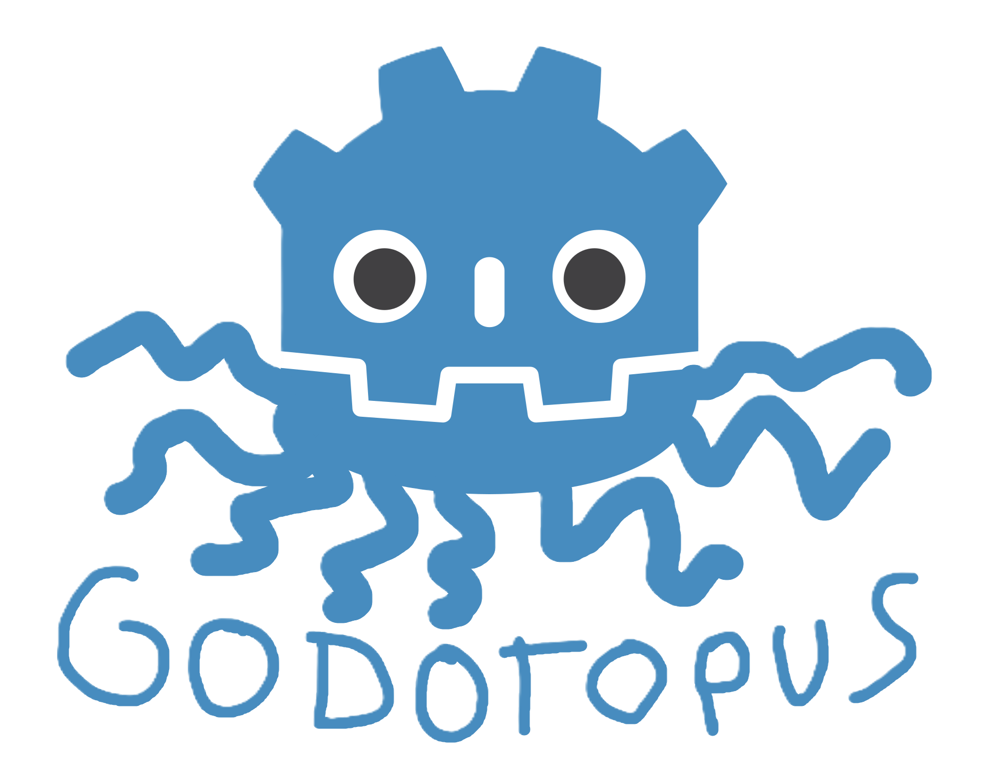

# Godotopus



A simple and usable GDExtension addon that provides VOIP for Godot 4 using Opus encoding and decoding.

> [!WARNING]
> This is a work in progress. It was originally just an internal addon for our games. Anything might end up changing, and there are likely lots of bugs. If you encounter any issues, or are super smart and have a better idea of what's going on than I do, please make an issue on the [GitHub Issues page](https://github.com/Mako-Mako-Games/godotopus/issues).


## Features

* Opus encoding, decoded on the audio thread through a custom `AudioStream`
* Plug-and-play `VoicePeer` node for Godot's high-level multiplayer
* Transport-agnostic: send packets over anything by extending `VoiceTransport`
* Silence isn't transmitted (Opus DTX)
* FEC (forward error correction) for recovering short burst packet loss
* Deep Redundancy (DRED) for recovering much longer packet loss bursts
* Network jitter compensation
* Senders and receivers need no shared settings: every packet describes its own format
* Output to multiple audio players (great for radios or clever effects!)
* Supports all `AudioStreamPlayer` node types
* Buildable without DNN-based features for much smaller compiled sizes


## Future Improvements

* Microphone pre-processing effects (noise suppression, AGC, etc.)
* Squeeze as much latency out of the system as possible
* Clearer name???


---

## Installation

1. Download the latest release for your platform. Releases include both the DNN-enabled and non-DNN binaries side by side.
2. Extract it into your project's `addons/` folder.
3. Enable the plugin in **Project Settings → Plugins**.
4. Enable **Audio → Driver → Enable Input** in the project settings so Godot can record the microphone.

---

## Usage

### With Godot's multiplayer: `VoicePeer`

Add a `VoicePeer` to each player's scene, and add one or more audio players to its **Players**
array. On the peer with multiplayer authority over it, it sends that peer's microphone; on every
other peer it plays that voice through the players.

* Set the node's multiplayer authority **before** it enters the tree (as you would for a scene
  spawned by a `MultiplayerSpawner`); it picks its role when it becomes ready.
* It must sit at the same node path on every peer, like any node that uses RPCs.
* **Encoder Settings** (`VoiceEncoderSettings`) and **Playback Settings** (`VoicePlaybackSettings`)
  are optional presets. Each node keeps its own copy, so one `.tres` can be shared safely.

### Building blocks

`VoicePeer` is a thin wrapper around three nodes you can also use directly:

* `VoiceSender` captures the microphone, encodes it and hands packets to a transport.
  Change `sender.settings` at runtime: codec options (bitrate, loss protection, DTX) apply
  immediately, and only a new sample rate, channel count or frame duration restarts the encoder.
* `VoiceReceiver` plays one sender's voice through any number of players. Feed it with
  `push_packet(packet, sequence)` or connect it to a transport.
* `VoiceTransport` moves packets between peers. `VoiceMultiplayerTransport` uses unreliable
  RPCs on a dedicated channel; `VoiceLoopbackTransport` sends packets back to itself (with
  optional simulated loss, delay and jitter) for testing. To use other networking, extend
  `VoiceTransport`: implement `send(packet, sequence)` and emit `packet_received(peer_id, packet,
  sequence)` when one arrives. Use an unreliable channel; resent audio only adds latency.

Each sender needs a microphone of its own: two senders reading the same input split it between them.

### Microphone input

By default `VoiceSender` reads the input device straight from the `AudioServer`. To run the
microphone through bus effects (e.g. a noise gate) before encoding, use a capture bus instead:

1. Create a new audio bus (for example, `VoiceCapture`), add an `AudioEffectCapture` to it, and mute it.
2. Add an `AudioStreamPlayer` with an `AudioStreamMicrophone` on that bus, and play it.
3. Set the sender's (or `VoicePeer`'s) **Capture Bus** to the bus name.

> [!NOTE]
> Opus decides what counts as silence with its own voice detector. Steady background noise
> from a microphone that hasn't picked up speech yet, or louder noise at any time, may never
> count as silent, so it keeps being sent. A noise gate or suppressor in front of the encoder
> (on a capture bus, or at the OS level) helps.

> [!NOTE]
> Make _SURE_ you don't end up creating multiple microphone recording AudioStreamPlayer nodes. I spent 5 hours straight trying to figure out why people's voices were playing back twice, just because I added one under a scene that gets instantiated twice!

### Demo

`demo/` is a Godot project with a loopback scene (hear yourself through a simulated bad network,
with live stats and a radio-effect player) and an ENet scene for voice chat between instances.
Run `scons install` first to copy the built addon into it.

---

## Building

Clone the repository with submodules:

```bash
git clone --recursive https://github.com/Mako-Mako-Games/godotopus.git
```

or

```bash
git clone --recursive git@github.com:Mako-Mako-Games/godotopus.git
```

Build from the repository root (requires Python 3 and `pip install scons`):

```bash
scons                      # builds into addons/godotopus/bin/
scons install              # also copies the addon into tests/godot and demo
```

Then copy `addons/godotopus/` into your project's `addons/` folder.

Godotopus requires Godot 4.7 or newer: it's built against the 4.7 API (`api_version` in the
SConstruct), using godot-cpp's version-independent `master` branch.

### Optional: DNN-based features

libopus's deep-learning features need a set of pretrained-weight source files that aren't in the
`opus` repository. They greatly increase the size of the compiled library, so releases come in a version with them and a version without. To build with them, use the `dnn=yes` flag:

```bash
scons dnn=yes
```

The ~130MB weights archive is downloaded once into `build/cache/opus_dnn/` (override with the
`GODOTOPUS_DNN_CACHE` environment variable), verified against the hash pinned by the opus submodule, and
extracted under `build/gen/`. The submodules are never modified.

### Tests

There are two suites, and CI runs both for every platform and flavor:

* **Native** (`tests/native`): doctest unit tests for the C++ core in `src/core`. They run without Godot.

  ```bash
  scons tests                     # add dnn=yes to cover the DNN features
  scons tests sanitize=address    # with AddressSanitizer + UBSan (GCC/Clang)
  scons tests sanitize=thread     # with ThreadSanitizer (GCC/Clang)
  ```

* **Godot** (`tests/godot`): gdUnit4 tests that run in headless Godot against the built addon.

  ```bash
  scons install
  python tools/fetch_gdunit4.py                       # once; installs the pinned gdUnit4
  python tools/run_godot_tests.py --godot /path/to/godot
  ```

---

## About

Godotopus is made by Mako Mako Games.

* Berti - Programmer (me)
* Pockette - UI/UX 
* Sazarn - Artist

We're a group of recent college graduates working on our first long-term Godot game!
If you'd like to follow development, check out our YouTube channel.
We'll also be releasing a devlog following the development of Godotopus soon!

https://www.youtube.com/@MakoMakoDev
